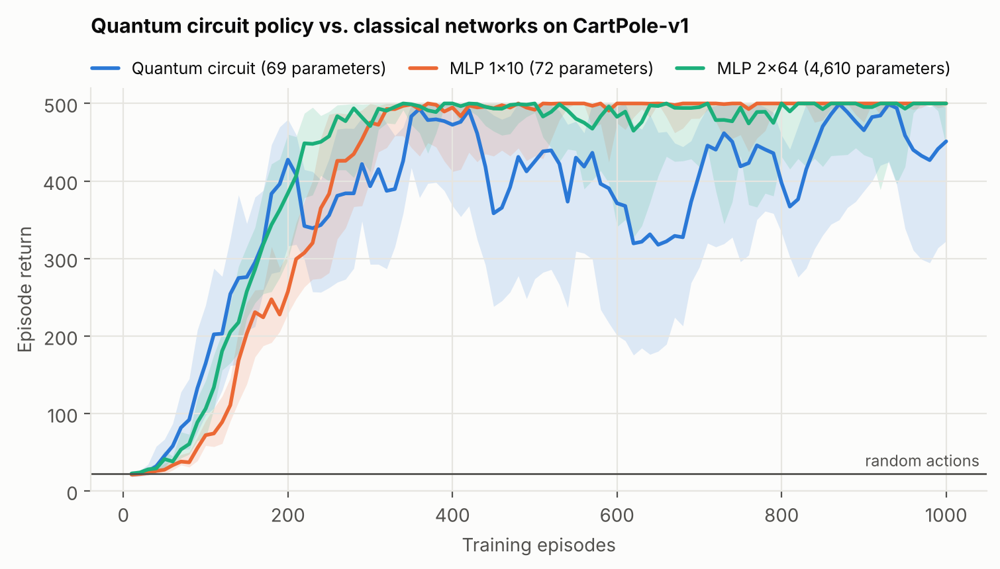
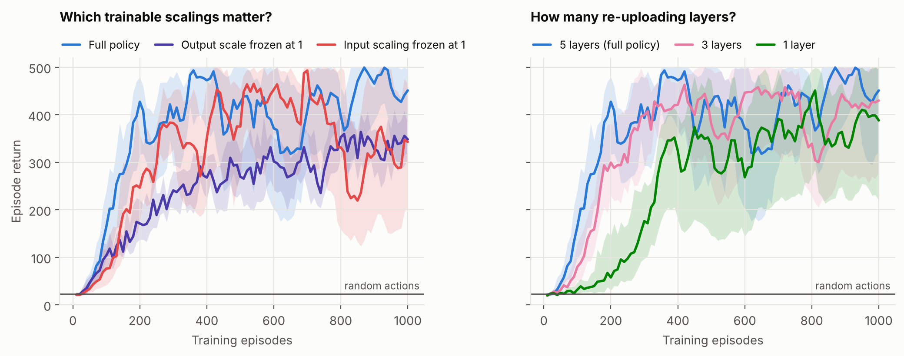
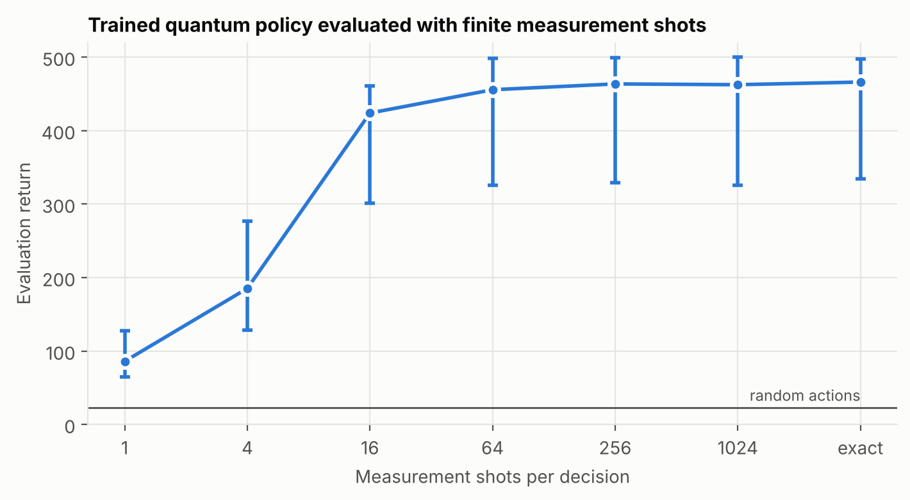

# A quantum circuit as a reinforcement-learning policy: a controlled CartPole study

A 4-qubit parametrised quantum circuit is trained with policy gradients to
balance a pole on a cart (`CartPole-v1`) and compared, under one protocol, with
classical neural networks — including one with the same parameter budget.
Three ablations then ask *which parts of the circuit policy actually matter*,
and a final experiment asks how many measurement shots the trained policy
needs per decision.

**This is a small, careful replication-style study, not a claim of quantum
advantage.** CartPole is easy for classical methods and a 4-qubit circuit is
trivially simulable. The point of the project is the methodology: a
from-scratch differentiable simulator verified against PennyLane, equal
hyper-parameter tuning for every model, 10 seeds per configuration, and
robust statistics with confidence intervals.

## Findings

All numbers are interquartile means (IQM) over 10 seeds with 95% bootstrap
confidence intervals; "return" is the number of time steps the pole stays up
(maximum 500).

1. **The quantum policy learns the task, but the classical baseline with the
   same number of parameters is better.** The 69-parameter circuit reaches the
   "solved" criterion (mean return ≥ 475 over 100 consecutive episodes) in
   10/10 seeds, after a median of 422 episodes. The 72-parameter MLP also
   solves 10/10 (median 362 episodes), ends at a higher return (499 vs. 459)
   and is far more stable late in training. The IQM difference in mean
   training return, quantum minus MLP, is −55 [−88, −24].
2. **A trainable output scale is essential.** With the inverse temperature
   frozen at 1, no run solves the task (0/10). The reason is structural: the
   circuit output is an expectation value in [−1, 1], so without rescaling the
   policy can never choose an action with probability above σ(2) ≈ 0.88.
3. **Trainable input scaling and circuit depth help, with weaker evidence.**
   Freezing the input scalings slows learning (median 584 vs. 422 episodes to
   solve; 9/10 solved). Fewer re-uploading layers solve less reliably (1 layer:
   5/10, 3 layers: 7/10, 5 layers: 10/10). The confidence intervals of these
   variants overlap with the full model on several metrics, so these are
   trends rather than established effects.
4. **About 64 measurement shots per decision are enough at inference time.**
   Estimating the circuit output from 64 shots gives a return of 456
   [325, 499] against 466 [334, 498] with exact expectation values; 16 shots
   already give 424 [301, 461].



*IQM over 10 seeds; shaded bands are pointwise 95% bootstrap intervals. Each
point is the mean on-policy return of one batch of 10 training episodes.*

| Policy | Trainable parameters | Final return, IQM [95% CI] | Training return, IQM [95% CI] | Runs solved | Median episodes to solve |
|---|---:|---:|---:|---:|---:|
| Quantum circuit, 5 layers (full) | 69 | 459 [358, 492] | 351 [319, 377] | 10/10 | 422 |
| – input scaling frozen | 49 | 333 [188, 465] | 304 [278, 330] | 9/10 | 584 |
| – output scale frozen | 68 | 332 [303, 356] | 246 [227, 265] | 0/10 | – |
| – 1 layer | 21 | 389 [243, 482] | 266 [175, 318] | 5/10 | 577 |
| – 3 layers | 45 | 421 [267, 490] | 348 [269, 382] | 7/10 | 380 |
| MLP 1×10 (matched budget) | 72 | 499 [493, 500] | 406 [385, 413] | 10/10 | 362 |
| MLP 2×64 | 4,610 | 493 [449, 500] | 406 [383, 422] | 10/10 | 322 |

*Final return*: mean over the last 100 training episodes. *Training return*:
mean over all 1,000 training episodes (area under the learning curve).
*Solved*: the trailing 100-episode mean reached 475 at some point during
training. A uniformly random policy scores 22.6.

Note that "solved at some point" and "final return" differ for the quantum
policy: every seed reaches the threshold, but two seeds (7 and 8) later
collapse and finish at returns of 176 and 279. Plain REINFORCE has no
safeguard against such collapses, and they are much rarer for the matched MLP
(final returns between 488 and 500 on every seed).





*Final checkpoints of the full quantum policy (10 seeds × 20 evaluation
episodes per shot budget). The wide intervals come from the two collapsed
seeds, which are kept in the analysis.*

## Method

### Task

[`CartPole-v1`](https://gymnasium.farama.org/environments/classic_control/cart_pole/)
from Gymnasium: a 4-dimensional continuous observation (cart position and
velocity, pole angle and angular velocity), two actions (push left/right),
reward +1 per step, episodes capped at 500 steps. It is the standard first
benchmark in the quantum-RL literature (Lockwood & Si 2020; Jerbi et al.
2021; Skolik et al. 2022), which makes results easy to put in context.

Observations are divided by `[2.4, 2.5, 0.2095, 2.5]` before being passed to
*any* policy. The first and third values are the environment's termination
thresholds; 2.5 for the unbounded velocities is the scale used in the
TensorFlow Quantum implementation of the agents of Jerbi et al.

### Quantum policy

One qubit per observation feature, `L` data re-uploading layers
(Pérez-Salinas et al. 2020):

```
|0000>
  │
  ├─ repeat L times:
  │     RY(θ) then RZ(θ) on every qubit        trainable rotations
  │     CZ on pairs (0,1) (1,2) (2,3) (3,0)    entangling ring
  │     RX(λ_i · s_i) on qubit i               encode feature s_i
  │
  ├─ RZ(θ) then RY(θ) on every qubit           trainable measurement basis
  ▼
measure <Z⊗Z⊗Z⊗Z>
```

- `θ`: trainable rotation angles, initialised uniformly in [−π, π).
- `λ`: trainable *input scalings*, one per qubit and layer, initialised to 1.
  They let the circuit choose the frequencies with which it sees each feature
  (Schuld et al. 2021).
- Output: the parity expectation `e(s) = ⟨Z⊗Z⊗Z⊗Z⟩ ∈ [−1, 1]`.
- Policy: `π(a | s) = softmax(w · [e(s), −e(s)])`, with a trainable inverse
  temperature `w` initialised to 1. After training `w` lies between 3.4 and
  4.6 across the 10 seeds.

The gate order is chosen so that no angle is trivially redundant (no RZ acting
on `|0⟩` or immediately before a Z-basis measurement); a unit test checks that
every parameter receives a non-zero gradient. With `L = 5` the policy has
`2·4·6 + 4·5 + 1 = 69` trainable parameters.

The design follows the *softmax-PQC* idea of Jerbi et al. (2021): data
re-uploading, trainable input scaling and a trainable weighting of the
measured observable. The specific gate layout above is a simplification
written for this project; no attempt is made to reproduce their numbers.

### Classical baselines

- **MLP 1×10**: one hidden layer of 10 tanh units, 72 parameters — at least
  as many as the circuit, so the comparison is not tilted towards the quantum
  model.
- **MLP 2×64**: two hidden layers of 64 tanh units, 4,610 parameters — a
  conventional "default" network as an upper reference.

### Training

REINFORCE (Williams 1992) with reward-to-go, discount γ = 0.99, batches of 10
episodes, and returns standardised across the batch (a constant baseline).
Adam, 100 updates = 1,000 episodes per run, no early stopping. For the quantum
policy the scalings `λ` and `w` use a separate, fixed learning rate of 0.1;
giving these parameter groups their own step size follows Jerbi et al. and
Skolik et al.

Training uses exact expectation values and reverse-mode autodiff through the
simulator. A unit test confirms these gradients equal the parameter-shift
gradients (Schuld et al. 2019) that a real device would have to estimate.

### Experimental protocol

- **Equal tuning.** Each policy class gets the same learning-rate grid
  `{0.001, 0.003, 0.01, 0.03, 0.1, 0.3}`, three pilot seeds (100–102) and the
  same selection criterion (mean training return). Selected: 0.03 (quantum),
  0.03 (MLP 1×10), 0.003 (MLP 2×64); none is on the edge of the grid. See
  `results/pilot/selection.json`.
- **Held-out seeds.** Reported results use seeds 0–9, which were never used
  for tuning.
- **Statistics.** IQM across seeds with 10,000-resample percentile-bootstrap
  intervals, following Agarwal et al. (2021).
- **Everything is kept.** All 70 runs are reported; no seeds were dropped or
  re-run.

## Reproducing the results

```bash
git clone <this repository> && cd pqc-policy-cartpole
python -m venv .venv && source .venv/bin/activate    # Windows: .venv\Scripts\activate
pip install -e ".[dev]"

pytest                                    # 48 tests, ~10 s
python scripts/select_learning_rates.py   # optional: repeats the pilot (~10 min)
python scripts/run_experiments.py         # 70 training runs
python scripts/evaluate_shots.py          # finite-shot evaluation
python scripts/make_report.py             # table and figures
```

The 70 training runs took 47 CPU-minutes in total (about 25 minutes of wall
time on two cores); no GPU is needed. Runs are seeded and deterministic on a
given machine and library version; across platforms, floating-point
differences can change individual trajectories, so expect the same
conclusions rather than bit-identical curves. The versions used are pinned in
`requirements.txt`. Raw per-episode returns and the trained weights of every
run are committed under `results/`, so the table and figures can be rebuilt
with `make_report.py` alone.

## Repository layout

```
src/qrl/
  simulator.py     batched, differentiable state-vector simulator (PyTorch)
  policies.py      QuantumPolicy, MLPPolicy, observation normalisation
  reinforce.py     episode collection, policy-gradient loss, training loop
  evaluate.py      evaluation with exact or finite-shot expectation values
  experiments.py   named configurations and the resumable multi-seed runner
  stats.py         IQM, bootstrap intervals, learning-curve summaries
scripts/           learning-rate selection, main sweep, shot study, report
tests/             unit tests (simulator is cross-checked against PennyLane)
results/           raw run files, checkpoints, summary table
figures/           figures used above
```

### Why a custom simulator?

Simulating each environment state separately inside an SDK is the bottleneck
of most quantum-RL code. Here the whole batch of states is one tensor, so a
5-layer circuit on 5,000 states is differentiated in about 0.2 s on one CPU
core, which is what makes a 70-run study practical on a laptop. Correctness is
not taken on trust: the tests compare gate matrices, the entangling layer, the
full policy circuit and its gradients against PennyLane's `default.qubit`.

## Limitations

- **No advantage is shown or claimed.** The task is classically easy and the
  circuit is classically simulable; the matched MLP outperforms the circuit.
- **Idealised quantum model.** Training is noiseless. Only shot noise is
  studied, and only at inference; gate errors, decoherence and readout errors
  are not modelled, and the policy is not trained under shot noise.
- **Simple algorithm.** REINFORCE without a learned critic has high variance
  and no protection against performance collapse, which affects the quantum
  policy most. Final checkpoints are evaluated; there is no model selection.
- **Statistical power.** Ten seeds give wide intervals. The learning-rate
  choice rests on three pilot seeds, and the ablated circuits reuse the full
  model's learning rate rather than being tuned separately, which may
  understate their performance.
- **Capacity matching.** Equal parameter count is a crude notion of equal
  capacity for two very different function classes.
- **One environment.** Conclusions may not transfer to other tasks.

## Possible extensions

- Train under shot noise and a gate-noise model, and measure the sample cost
  of parameter-shift gradients on this task.
- Replace REINFORCE with an actor-critic to separate "circuit as a function
  approximator" from "high-variance gradient estimator".
- Study how gradient magnitudes scale with qubit count and depth on tasks with
  larger observation spaces (barren plateaus).

## References

- R. Agarwal, M. Schwarzer, P. S. Castro, A. Courville, M. G. Bellemare.
  *Deep Reinforcement Learning at the Edge of the Statistical Precipice.*
  NeurIPS 2021. [arXiv:2108.13264](https://arxiv.org/abs/2108.13264)
- A. G. Barto, R. S. Sutton, C. W. Anderson. *Neuronlike adaptive elements
  that can solve difficult learning control problems.* IEEE Trans. Systems,
  Man, and Cybernetics 13(5), 1983.
- S. Jerbi, C. Gyurik, S. C. Marshall, H. J. Briegel, V. Dunjko.
  *Parametrized quantum policies for reinforcement learning.* NeurIPS 2021.
  [arXiv:2103.05577](https://arxiv.org/abs/2103.05577)
- O. Lockwood, M. Si. *Reinforcement Learning with Quantum Variational
  Circuits.* AIIDE 2020. [arXiv:2008.07524](https://arxiv.org/abs/2008.07524)
- A. Pérez-Salinas, A. Cervera-Lierta, E. Gil-Fuster, J. I. Latorre. *Data
  re-uploading for a universal quantum classifier.* Quantum 4, 226 (2020).
- M. Schuld, V. Bergholm, C. Gogolin, J. Izaac, N. Killoran. *Evaluating
  analytic gradients on quantum hardware.* Phys. Rev. A 99, 032331 (2019).
- M. Schuld, R. Sweke, J. J. Meyer. *Effect of data encoding on the expressive
  power of variational quantum-machine-learning models.* Phys. Rev. A 103,
  032430 (2021).
- A. Skolik, S. Jerbi, V. Dunjko. *Quantum agents in the Gym: a variational
  quantum algorithm for deep Q-learning.* Quantum 6, 720 (2022).
  [arXiv:2103.15084](https://arxiv.org/abs/2103.15084)
- M. Towers et al. *Gymnasium: A Standard Interface for Reinforcement Learning
  Environments.* [arXiv:2407.17032](https://arxiv.org/abs/2407.17032)
- R. J. Williams. *Simple statistical gradient-following algorithms for
  connectionist reinforcement learning.* Machine Learning 8, 229–256 (1992).

## Acknowledgements

Built with PennyLane [11] and scikit-learn [13].

## Licence

MIT — see [LICENSE](LICENSE).
